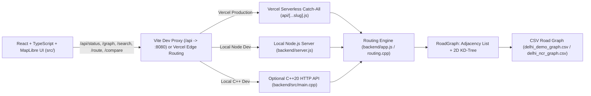

# MapNav (Map Navigator)

An interactive Delhi NCR route-planning, DSA visualization, and turn-by-turn navigation web app powered by a custom road-graph routing engine. The browser requests routes from the API, receives road-following GeoJSON polylines, explored-node traces, algorithm benchmarks, and turn-by-turn maneuvers, and renders them on an interactive MapLibre map. Navigation mode watches browser geolocation (with permission), follows the live position marker, and automatically recalculates the route after a meaningful deviation.

## Features

- **Interactive Map UI**: React + TypeScript + MapLibre GL interface with map-click or landmark-search origin/destination selection, toggleable graph-node and explored-node overlays, route objectives, distance/ETA display, and step-by-step maneuvers.
- **4 Routing Algorithms + Live Benchmark**: Compare **A\***, **Dijkstra**, **BFS**, and **DFS** side-by-side on the live Delhi NCR road graph with visited-node counts, path distances, execution times (μs), and optimality indicators.
- **Route Objectives**: `fastest` (edge travel-time) and `shortest` (edge distance).
- **Single-Platform Vercel Deployment**: Runs both the Vite/React frontend and the Node.js routing API (`api/[...slug].js` + `backend/app.js`) directly on Vercel with zero external backend dependencies.
- **C++20 Native Parity**: Includes an equivalent C++20 HTTP engine (`backend/src/`) using the exact same CSV graph format, KD-tree snapping, and routing algorithms.
- **Road-Graph Tooling**: Includes a 3,660-node / 7,436-directed-edge Delhi NCR starter graph (`backend/data/delhi_demo_graph.csv`) plus Python scripts (`backend/tools/`) to rebuild corridor graphs or import bounded OpenStreetMap XML extracts.

---

## System Architecture



### Request Lifecycle

1. **Startup / Cold Start**: The backend loads the CSV graph (`delhi_ncr_graph.csv` if present, otherwise `delhi_demo_graph.csv`), constructs the directed adjacency list, precomputes projected meter coordinates (`xMeters`, `yMeters`), builds the 2D KD-tree spatial index, and runs JIT warmup queries.
2. **Initial Map Load (`/api/graph`)**: The frontend fetches all nodes, landmark flags, and deduplicated road segments to render the interactive road network and clickable landmark pins.
3. **Snapping & Routing (`/api/route`)**: Origin and destination coordinates are snapped to the nearest road-graph node via the KD-tree (within a 3,000 m maximum snap radius), routed using the chosen algorithm (`astar`, `dijkstra`, `bfs`, or `dfs`), and returned with path coordinates, explored node IDs, and turn-by-turn maneuvers.
4. **Algorithm Comparison (`/api/compare`)**: Runs A\*, Dijkstra, BFS, and DFS on the same origin/destination pair, benchmarks execution time, and flags suboptimal paths relative to Dijkstra's optimal cost.

---

## Graph Design & Data Structures

### 1. Directed Adjacency-List Graph (`RoadGraph`)

- **Nodes**: Each node stores its sequential integer ID, geographic coordinate (`latitude`, `longitude`), display label / road name, `isLandmark` flag, and equirectangular meter projection (`xMeters`, `yMeters`) around Delhi NCR (`28.6139° N`) for fast heuristic evaluation.
- **Edges**: Stored as a directed adjacency list (`adjacency[u] -> [{ to, meters, seconds, road_name }]`).
  - Edge length (`meters`) is computed from node coordinates using the **Haversine formula** ($R = 6{,}371{,}000\text{ m}$).
  - Edge travel time (`seconds`) is computed as $\text{meters} / (\text{speedKph} / 3.6)$, with a minimum speed floor of `5 km/h`.
  - Bidirectional roads (`B`) insert directed edges in both directions; one-way roads (`F`) insert a single directed edge.

### 2. 2D KD-Tree Spatial Index

- To snap arbitrary map clicks or GPS positions to the nearest road node without scanning every node linearly, `RoadGraph` builds a balanced **2D KD-tree** alternating splits on `latitude` (even depths) and `longitude` (odd depths).
- Nearest-neighbor queries prune branches whose perpendicular degree offset converted to meters exceeds the current best Haversine distance, then enforce a `3,000 m` maximum snap distance.

### 3. Routing Algorithms & Priority Queue

| Algorithm | Data Structure | Objective Cost | Optimal? | Notes |
| --- | --- | --- | --- | --- |
| **A\*** (`astar`) | Binary min-heap (`Float64Array` / `Int32Array`) | $g(n) + h(n)$ | Yes | Uses Euclidean meter distance on projected coordinates; scaled by $1 / (45\text{ km/h})$ for `fastest`. |
| **Dijkstra** (`dijkstra`) | Binary min-heap (`Float64Array` / `Int32Array`) | $g(n)$ | Yes | Uniform-cost search ($h = 0$); baseline for optimality checks. |
| **BFS** (`bfs`) | FIFO queue | Hop count | Unweighted only | Finds fewest-hop path; typically suboptimal in distance/time. |
| **DFS** (`dfs`) | LIFO stack | Traversal order | No | Explores deep corridors first; demonstrates non-optimal traversal. |

### 4. Turn-by-Turn Maneuver Generation

- Consecutive edges along the reconstructed `parent` path are grouped by `road_name`.
- Whenever the road name changes, forward bearings before and after the intersection are compared:
  - $|\Delta\theta| < 28^\circ$: `Continue`
  - $|\Delta\theta| > 145^\circ$: `Make a U-turn`
  - $\Delta\theta > 0$: `Turn right`, otherwise `Turn left`
- Same-name consecutive segments accumulate into a single maneuver's `metersToNext`.

### 5. Graph CSV Format & Datasets

The server loads `backend/data/delhi_ncr_graph.csv` when present, falling back to the bundled `backend/data/delhi_demo_graph.csv` (**3,660 nodes**, **7,436 directed edges**, **48 Delhi NCR landmarks** across ~105 road corridors).

```text
N|internal-id|latitude|longitude|display name
E|from-id|to-id|road name|speed-kph|B-or-F
```

- `N` lines define sequential node IDs (`0..N-1`); non-landmark geometry points use `OSM node ...` names (automatically promoted to adjacent road names on load).
- `E` lines define edges with road name, speed in km/h, and directionality (`B` = bidirectional, `F` = forward one-way).
- **Starter graph generator** (`backend/tools/build_delhi_road_graph.py`): Samples arterial corridors ($\ge 40\text{ km/h}$) at ~150 m resolution and collector corridors ($\le 35\text{ km/h}$) at ~750 m resolution, removing divided-carriageway U-turn loops.
- **Full OSM XML importer** (`backend/tools/osm_to_graph.py`): Converts a bounded OpenStreetMap XML extract while preserving drivable road tags and one-way rules:

```bash
python3 backend/tools/osm_to_graph.py /path/to/delhi.osm backend/data/delhi_graph.csv
NAVIGATOR_GRAPH=backend/data/delhi_graph.csv ./backend/bin/navigator_api
```

> Before calling a large-city OSM extract production-ready, add turn-restriction relations and a dedicated tile/geocoding provider.

---

## Run Locally

The simplest way to start both the Node.js backend API and the Vite frontend is:

```bash
npm install
npm run dev:full
```

Then open `http://127.0.0.1:5173`.

Alternatively, run the backend and frontend in separate terminals:

**Option A — Node.js backend:**
```bash
npm run api
npm run dev
```

**Option B — C++20 backend:**
```bash
make -C backend
./backend/bin/navigator_api
```
Then in another terminal:
```bash
npm run dev
```

The Vite dev server proxies `/api` requests to `http://127.0.0.1:8080`.

---

## Deploy on Vercel

The repository is configured for zero-config full-stack deployment on Vercel:

- Static React/Vite frontend builds from `npm run build` into `dist/`.
- [api/[...slug].js](api/%5B...slug%5D.js) exposes all `/api/*` endpoints as a Vercel Serverless Function backed by `backend/app.js`.
- [vercel.json](vercel.json) bundles `backend/data/*.csv` with the serverless function so the 3,660-node graph loads out of the box without any external API host.

---

## API Endpoints

| Endpoint | Description |
| --- | --- |
| `GET /api/status` | Engine status, node count, and directed edge count |
| `GET /api/graph` | Full node list (`id`, `name`, `latitude`, `longitude`, `isLandmark`) and deduplicated edge pairs |
| `GET /api/search?q=<query>` | Landmark autocomplete search (up to 15 matches) |
| `GET /api/route?fromLat=...&fromLng=...&toLat=...&toLng=...&objective=fastest\|shortest&algorithm=astar\|dijkstra\|bfs\|dfs` | Computes route geometry, distance, duration, visited nodes, execution time, and maneuvers |
| `GET /api/compare?fromLat=...&fromLng=...&toLat=...&toLng=...&objective=fastest\|shortest` | Benchmarks A\*, Dijkstra, BFS, and DFS side-by-side |

Example queries:

```bash
curl 'http://127.0.0.1:8080/api/status'
curl 'http://127.0.0.1:8080/api/search?q=India'
curl 'http://127.0.0.1:8080/api/route?fromLat=28.6129&fromLng=77.2295&toLat=28.5702&toLng=77.3240&objective=fastest'
curl 'http://127.0.0.1:8080/api/compare?fromLat=28.6129&fromLng=77.2295&toLat=28.5702&toLng=77.3240&objective=fastest'
```

---

## Map and Provider Notes

MapLibre renders the map; it is not the routing provider. The bundled demo uses OpenStreetMap raster tiles only for normal interactive development. Preserve visible attribution and do not bulk-prefetch or scrape those public tiles. Public Nominatim should not be used for client-side autocomplete; replace the local landmark search with a properly configured geocoding-provider adapter for broader place search.

---

## Project Layout

```text
src/                    React + TypeScript + MapLibre navigation UI
api/[...slug].js        Vercel Serverless Function entrypoint for /api/*
backend/app.js          Shared Node.js road-graph routing engine & HTTP handler
backend/server.js       Local Node.js HTTP server wrapper
backend/src/            C++20 graph, routing algorithms (A*, Dijkstra, BFS, DFS), and HTTP API
backend/data/           Runnable Delhi NCR starter graph (delhi_demo_graph.csv)
backend/tools/          OSM XML importer & Delhi road-graph builder scripts
scripts/dev-full.mjs    Combined backend + Vite dev launcher
vercel.json             Vercel serverless function bundling config
```
